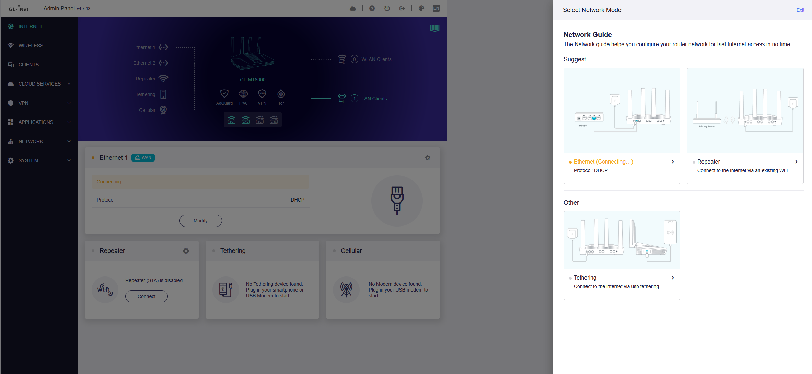
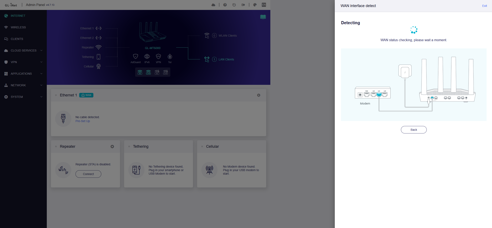
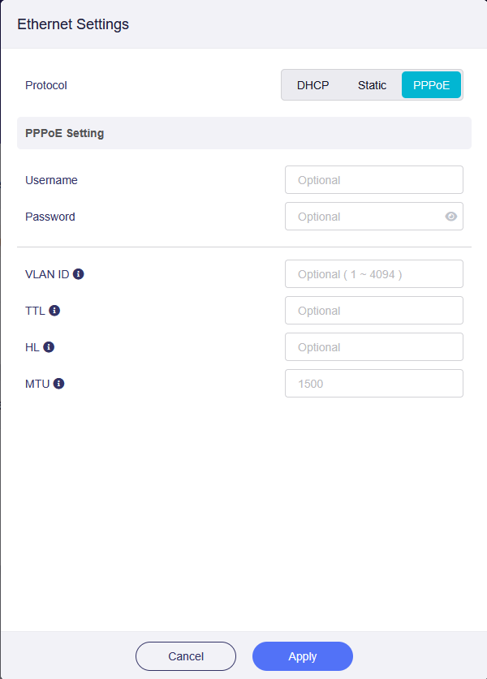
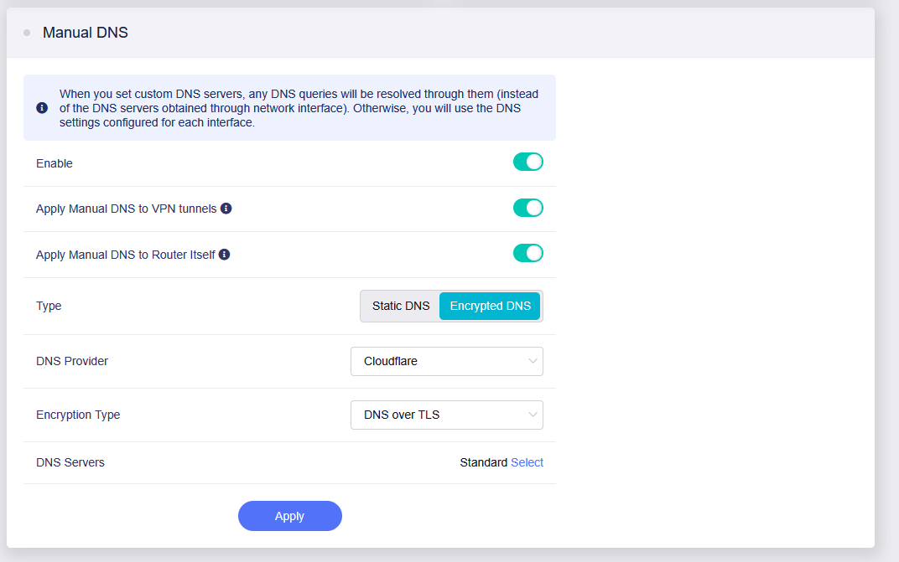
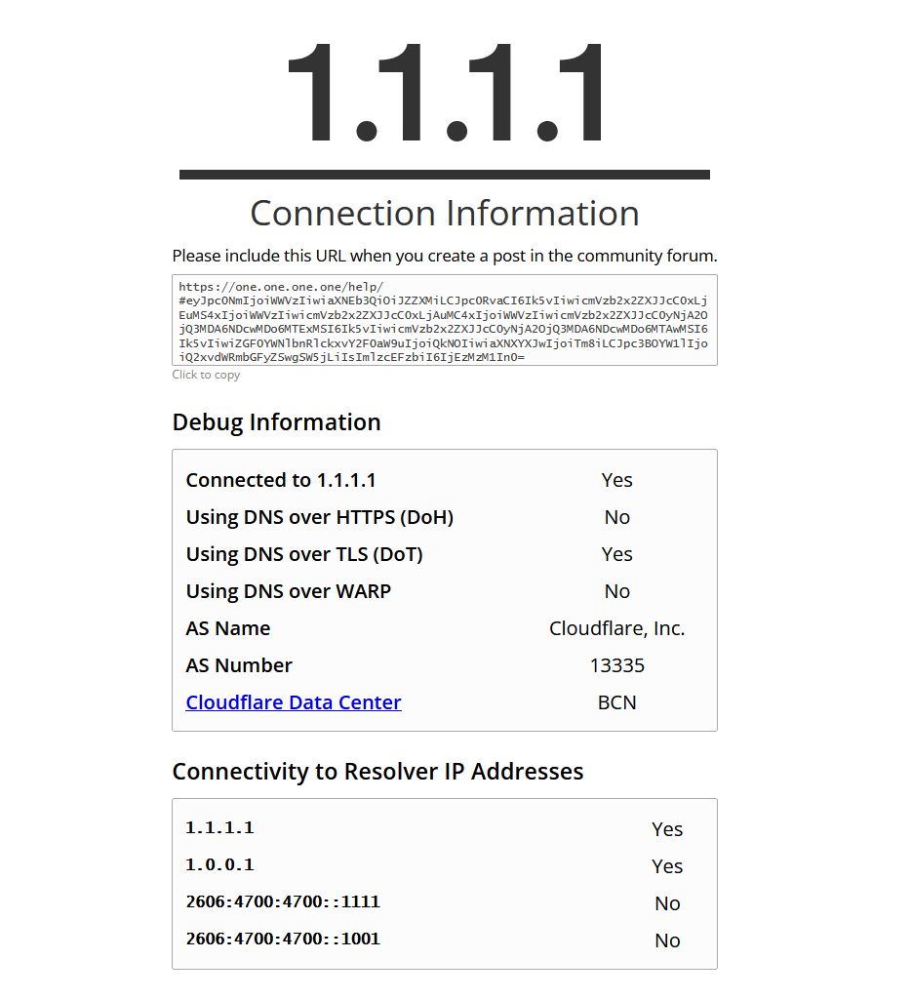
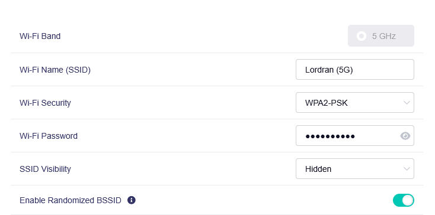
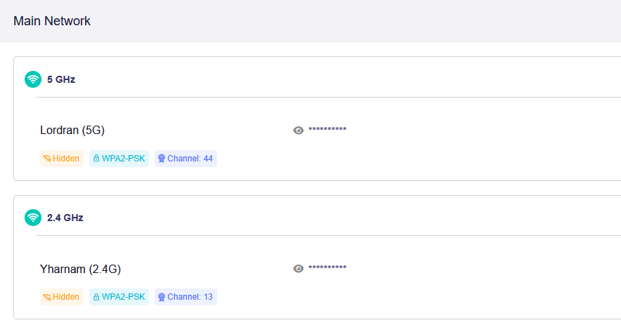
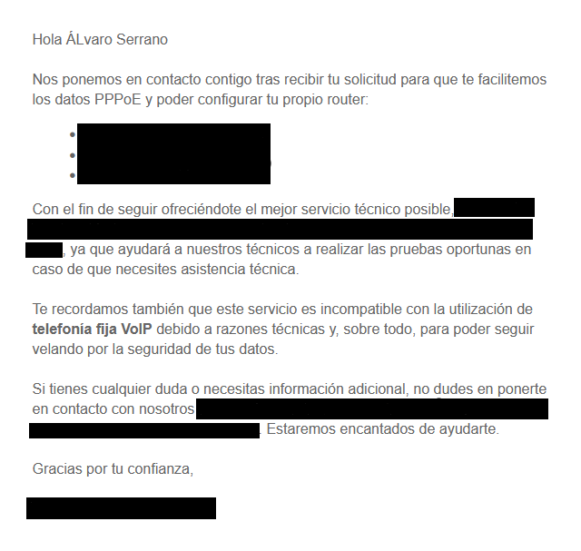

# 📓 Diario de Desarrollo: [Intranet Doméstica]

> 👥 **Autores:** Álvaro Serrano

> **Descripción corta:** El proyecto escogido consiste en el desarrollo de una red privada, con sus pertinentes servicios y herramientas, que funcione tanto para el entorno doméstico como para el profesional; una intranet doméstica en toda regla.

> 📅 **Fecha de inicio:** [07/10/2026]

> 🚀 **Estado actual:** Versión Alfa

---

## 📌 Tabla de Contenidos
* [Visión General y Tecnologías](#-MVP-y-Visión-General)
* [Bitácora](#-Bitácora)
* [Problemas Conocidos y Soluciones](#-Problemas-Conocidos-y-Soluciones)

---

## 🛠️ MVP y Visión General

* **Red segmentada.** Se dispondrá de una red que separe los dispositivos en varios grupos: red de invitados, taller, domótica, …
* **Túnel VPN.** Usando la tecnología nativa de Wireguard (más adelante se especifica el router).
* **Bloqueo y cifrado por DNS.** Mediante tecnología DNS-over-HTTPS y estableciendo listados.
* **Configuración del Firewall.** Filtrando el tráfico entre la red privada e internet o entre las VLANs.
* **Registro y análisis del tráfico.** Mediante paquetes de OpenWRT y el almacenamiento a través de un servicio de Syslog externo al router.
* **Empaquetado de servicios.** No todo cabe ni debe de estar en el router por lo que se usará un dispositivo con Docker para ciertos servicios.

Quedará limitado al domicilio: no busco contratar un VPS, crear un dominio, negociar o pedir nuevos servicios a mi ISP, etc. La intención es hacer todo lo que se pueda desde mi propio router y mi estación de trabajo.

### Stack Tecnológico
* **Dispositivos:** GL-MT6000, Raspberry PI 5

---

## 📝 Bitácora

<!--
### 📅 [DD/MM/AAAA] - [Motivo]
  * 
  * 
  * 
  

--- 
-->

### 📅 [13/10/2026] - [Router: Instalación y configuración Inicial]
* **Avances:**

Tras buscar un hueco y conectar los distintos dispositivos necesarios para el proyecto, accedí a la dirección del router para llevar a cabo las configuraciones iniciales; en el primer inicio de sesión, el router solicita un cambio de contraseña (la cual generé en una kbdx, base de datos para contraseñas, en keepassxc).

  

Una vez en el panel, los primeros pasos fueron especificar las credenciales otorgadas por mi proveedor de internet, aquí tuve que especificar la VLAN dentro de la red de mi ISP y las credenciales reservadas para contrato.

 <table>
   <caption>Paneles de bienvenida</caption>
   <tr>
     <td></td>
     <td></td>
     <td></td>
   </tr>
 </table>

A continuación, tras verificar la conexión y hacer pruebas de velocidad, procedí a cambiar el DNS de mi ISP por el de Cloudflare y habilitar la encriptación vía DoT; esta primera configuración es provisional y se actualizará con la instalación de una VPN (WARP de Cloudflare). El objetivo final de este apartado es garantizar una conexión segura, privada y rápida.

 <table>
   <caption>Configuración del DNS</caption>
   <tr>
     <td></td>
     <td></td>
   </tr>
 </table>

Por último cambié el SSID (para que no figurara el modelo de mi router como nombre de red), establecí una nueva contraseña mediante KeepassXC y oculté la red.

 <table>
   <caption>Personalización del Wi-Fi</caption>
   <tr>
     <td></td>
     <td></td>
   </tr>
 </table>

* **Retos / Bloqueos:** 
  * La conexión a internet del router no funcionaba en primera instancia por la PPPoE, tuve que solicitar las credenciales al servicio técnico de mi ISP.

   
  

---
<!--
### 📅 [19/10/2026] - [SBC: Instalación y configuración Inicial]
* **Avances:**

* **Retos / Bloqueos:** 

---

### 📅 [22/10/2026] - []
  * 
  * 
  * 

---
-->

<!--
## ⚠️ Problemas Conocidos y Soluciones

| Error / Bug | Causa | Solución |
| :--- | :--- | :--- |
-->